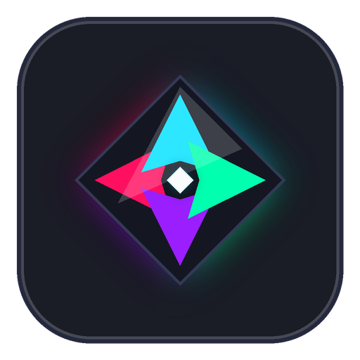
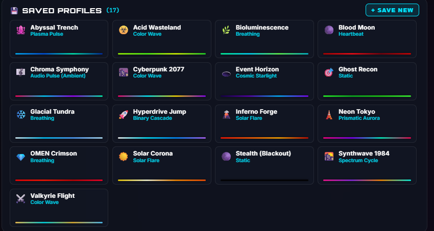
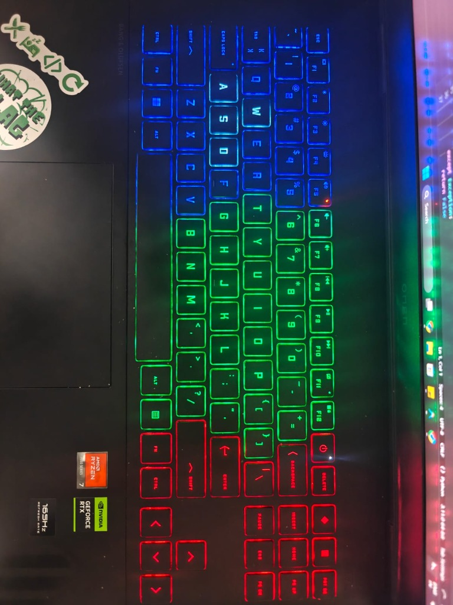

# OmenFLUX — 4-Zone RGB Lighting Controller

<p align="center">
  
</p>

<p align="center">
  <b>A lightweight, high-performance, dark-themed RGB keyboard lighting controller and customization studio engineered for HP OMEN 16 and compatible 4-zone laptops.</b>
</p>

<p align="center">
  
  
  
  
  
</p>

---

## App Interface Preview

<p align="center">
  
</p>

### Physical 4-Zone Hardware Illumination
<p align="center">
  
</p>

---

## Table of Contents

1. [Overview](#overview)
2. [How to Install & Run (Current Release)](#how-to-install--run-current-release)
3. [Key Features](#key-features)
4. [Hardware 4-Zone Mapping](#hardware-4-zone-mapping)
5. [Exclusive Signature Mode: Apex Overdrive](#exclusive-signature-mode-apex-overdrive)
6. [Roadmap: Moving from Chromium to Native Windows App](#roadmap-moving-from-chromium-to-native-windows-app)
7. [CLI Reference](#cli-reference)
8. [Building from Source](#building-from-source)
9. [Project Structure](#project-structure)
10. [License](#license)

---

## Overview

Official gaming hub software suites often consume over **1 GB of system RAM** across dozens of telemetry and background services just to control keyboard lighting.

**OmenFLUX** was created as an ultra-lightweight alternative (~15 MB RAM) that interacts directly with low-level Win32 Shared Memory buffers (`FourZoneLightingData`) and the ACPI WMI BIOS. It is designed to **coexist seamlessly** with official manufacturer background services without conflicts, service crashes, or restarts.

---

## How to Install & Run (Current Release)

### Method 1: Standalone Windows Executable (Recommended)

No Python installation required.

1. **Download**:
   - Clone or download this repository.
   - The compiled standalone executable is located in `dist\OmenFLUX.exe`.
2. **Setup Desktop & Start Menu Shortcuts**:
   - Run the included shortcut utility to create clean Windows Desktop and Start Menu entries:
     ```powershell
     py -3.11 setup_shortcuts.py
     ```
   - Alternatively, right-click `dist\OmenFLUX.exe` and select **Pin to Taskbar** or **Create Shortcut**.
3. **Launch**:
   - Double-click `OmenFLUX.exe` (or the desktop shortcut).
   - OmenFLUX automatically discovers the running background helper service, takes ownership, and presents the studio UI.
4. **Startup & Background Controls**:
   - Click **[ 🗕 BACKGROUND ]** in the header to minimize to the Windows System Tray.
   - Click **[ 🚀 STARTUP: ON ]** to enable or disable automatic launch on Windows boot.
   - Click **[ ✖ EXIT ]** to close OmenFLUX and automatically hand lighting control back to default system services.

---

### Method 2: Running from Source

**Prerequisites**:
- Windows 10 or 11 (64-bit)
- Python 3.10+ (tested on Python 3.11)
- Modern browser (Google Chrome or Microsoft Edge installed, standard on Windows)

```powershell
# 1. Clone the repository
git clone https://github.com/Abhay-K04/OmenFLUX.git
cd OmenFLUX

# 2. Install dependencies
py -3.11 -m pip install -r requirements.txt

# 3. Launch OmenFLUX Studio
py -3.11 main.py

# Or launch directly in silent System Tray background mode
py -3.11 main.py --background
```

---

## Key Features

- **Coexistence Mode**: One-click handover between OmenFLUX and manufacturer lighting services with zero process crashes.
- **14 Procedural Lighting Effects**: Smooth, 60 FPS animation routines including wave sweeps, breathing oscillations, cardiac pulses, plasma resonance, and reactive typing ripples.
- **20 Curated Preset Profiles**: Instant aesthetic themes ranging from vibrant esports setups to calming pastel palettes (*Apex Vanguard*, *Sakura Blossom*, *Quantum Prism*, *Synthwave 1984*, *Cyberpunk 2077*, and more).
- **Chroma Studio with Lighter Colors**: Circular HSV color canvas with an intelligent palette randomizer that generates pastel, tint, accent, and neon colorways.
- **Photorealistic Virtual Keyboard**: Interactive 3D keycaps with physical typing feedback, WASD cluster callout, and translucent underglow diffusion.
- **Deep Power Optimization**: Dynamic sleep throttling (100 ms) during static states to allow CPU C-states and preserve laptop battery life.
- **System Tray Integration**: Quiet background daemon with quick-access menu for switching profiles, taking control, or exiting.

---

## Hardware 4-Zone Mapping

Through hardware-level reverse engineering of the motherboard LED bus, the 4 lighting zones on the HP OMEN 16 are mapped as:

| Zone Index | Zone Name | Physical Hardware Region Covered |
|:---:|:---|:---|
| **Zone 0** | **WASD Keys** | Dedicated physical `W`, `A`, `S`, `D` movement cluster |
| **Zone 1** | **Left Section** | `Esc`, `F1-F4`, `~`, `1-4`, `Tab`, `Q`, `E`, `Caps`, `Shift`, `Z-C`, `Ctrl`, `Win`, `Alt` |
| **Zone 2** | **Center Section** | `F5-F10`, `5-0`, `R-O`, `F-L`, `V-M`, Spacebar, Menu |
| **Zone 3** | **Right / Nav Section** | `F11-F12`, `- =`, `Backspace`, `P`, `[ ] \`, `Enter`, Arrow keys, Nav cluster |

---

## Exclusive Signature Mode: Apex Overdrive

Exclusive to the **Apex Vanguard** profile, **Apex Overdrive** is an interactive kinetic combo engine:

1. **Ambient Arcade Ricochet (Idle)**:
   - When idling, dual laser energy beams bounce continuously across physical zones with luminous particle reflections.
   - Base palette: Solar Amber-Gold (WASD), Neon Violet (Left), Cyber Cyan (Center), Plasma Coral (Right).
2. **Real-Time Combo Heat Gauge (Typing & Gaming)**:
   - Keystrokes on the physical keyboard (polled at 125 Hz) or virtual keyboard inject heat into an internal accumulator.
   - The pressed zone immediately bursts with a kinetic shockwave, and the laser beams accelerate.
3. **God-Mode Super Overdrive (Frenzy)**:
   - Rapid key strikes push the heat gauge beyond 0.35, accelerating animations up to **3.5x speed**.
   - Multi-zone energy strobes ignite with white-hot spark glints, while the WASD cluster flashes with blinding golden lightning!
   - When typing stops, heat vents smoothly over ~2.8 seconds back to the ambient rhythm.

---

## Roadmap: Moving from Chromium to Native Windows App

### Current Implementation (Chromium App Mode)
Currently, OmenFLUX runs a local Flask backend server (`127.0.0.1:54321`) and renders its front-end by launching Microsoft Edge or Google Chrome in application mode (`--app=http://...` with `--window-size`). 

While this provides hardware-accelerated CSS underglow effects, 60 FPS canvas animations, and zero address bar/tabs:
- It spawns a browser helper process (~60–80 MB RAM for Chromium renderers).
- It depends on Edge/Chrome being present on the machine.
- Window management (frameless borders, title bar snapping) relies on browser window flags.

### Planned Transition to a Pure Native Windows App

To make OmenFLUX a 100% native Windows desktop application, the following architectural upgrades are planned:

| Approach | Technology Stack | Benefits | Status |
|:---|:---|:---|:---:|
| **Option A (Short-Term)** | **Native WebView2 Wrapper** (`pywebview` / C# WinUI 3) | Uses Windows' built-in Evergreen WebView2 runtime. Eliminates external browser window launches, adds native Windows 11 **Mica / Acrylic** blur, and native window drag/snap. | In Planning |
| **Option B (Long-Term)** | **Tauri v2 (Rust Backend + Native Webview)** | Replaces Python + Flask with a compiled Rust binary communicating directly with Win32 Shared Memory. Drops executable size to ~4 MB and RAM usage to under 10 MB with instantaneous cold start. | Researching |
| **Option C (Full Native)** | **C++ / WinUI 3 / DirectX 12** | Complete pure-native rewrite with Direct2D/DirectX keycap rendering and zero web runtime dependencies. | Under Consideration |

### Additional Planned Features
- [ ] **WASAPI Audio Loopback Visualizer**: Direct Windows Core Audio capture for real-time sound-reactive spectrum visualization.
- [ ] **External Peripheral Support (OpenRGB Integration)**: Synchronize lighting with external USB keyboards (ASUS TUF, Razer, Corsair) and mice.
- [ ] **Per-Key RGB Mapping**: Expanded LED array support for flagship OMEN models featuring 100+ addressable keys.
- [ ] **Game State Integration**: Health bar, ammo counter, and Discord mute status lighting alerts.

---

## CLI Reference

OmenFLUX supports direct command-line operations for scripting and automation:

```powershell
# Display live hardware and handover status
py main.py --status

# Apply a preset directly from terminal
py main.py --profile "Apex Vanguard"
py main.py --profile "Sakura Blossom"
py main.py --profile "OMEN Crimson"

# Handover controls
py main.py --take-control
py main.py --release

# Silent background execution (System Tray only)
py main.py --background
```

---

## Building from Source

To compile the standalone `.exe` using PyInstaller:

```powershell
py -3.11 -m pip install pyinstaller
py -3.11 -m PyInstaller --noconfirm OmenFLUX.spec
```

The compiled binary will be placed at `dist\OmenFLUX.exe`.

---

## Project Structure

```text
OmenFLUX/
├── main.py                     # Primary entrypoint & CLI dispatcher
├── setup_shortcuts.py          # Windows Desktop, Start Menu & Registry setup
├── OmenFLUX.spec               # PyInstaller standalone build configuration
├── requirements.txt            # Python package dependencies
├── README.md                   # Project documentation
├── LICENSE                     # MIT License
├── docs/
│   └── images/                 # Documentation screenshots and previews
└── omenglow/                   # Core application package
    ├── assets/                 # Icons, emblems, and graphic assets
    ├── effects/
    │   └── engine.py           # 60 FPS animation engine & effects routines
    ├── hardware/
    │   ├── shared_memory.py    # Win32 Memory-Mapped File IPC pipeline
    │   ├── handover.py         # Process suspension and handover controller
    │   └── wmi_bios.py         # Fallback WMI ACPI BIOS communication
    ├── profiles/
    │   └── manager.py          # Profile JSON persistence and preset manager
    ├── ui/                     # Fallback desktop GUI components
    └── web/                    # Modern Studio Web UI
        ├── server.py           # Flask REST API and live state broadcaster
        ├── templates/
        │   └── index.html      # Desktop studio interface
        └── static/
            ├── css/            # Cyber-stealth dark styling
            └── js/             # Frontend logic, keyboard model, and color wheel
```

---

## License

This project is licensed under the [MIT License](LICENSE).
All product and company names are trademarks™ or registered® trademarks of their respective holders. Use of them does not imply any affiliation with or endorsement by them.
